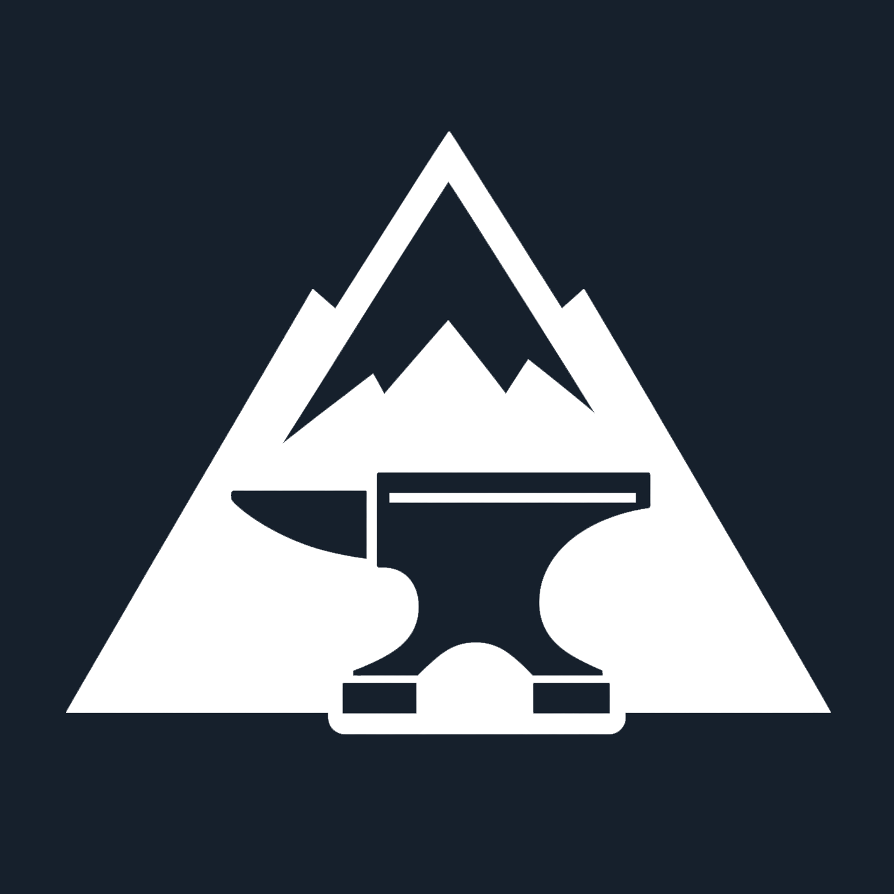
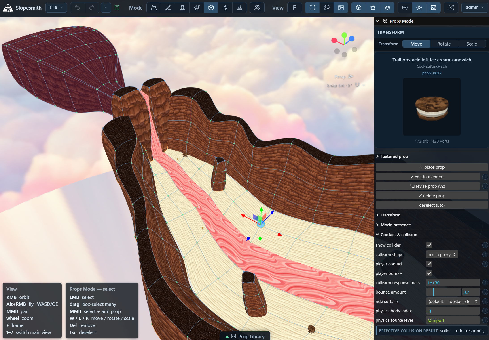
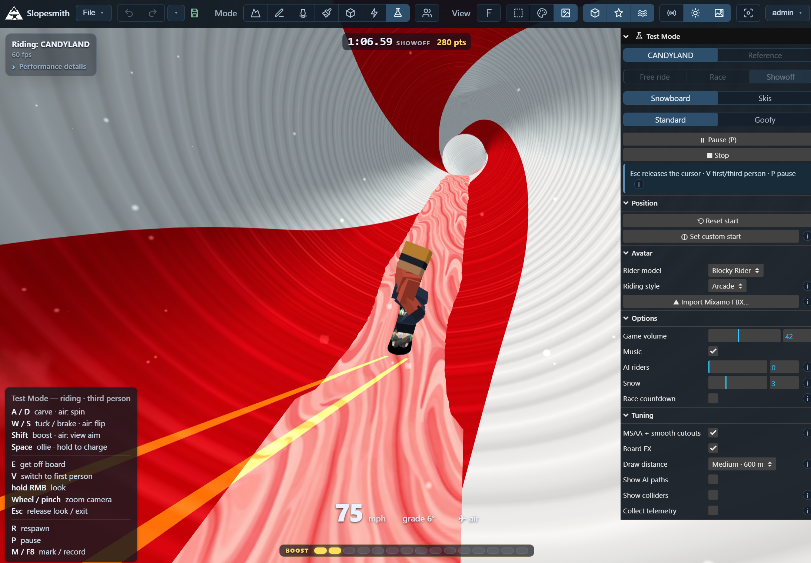

<p align="center">
  <a href="https://slopesmith.net"></a>
</p>

<h1 align="center">OpenSlope</h1>

<p align="center">
  <b>Build and ride <i>SSX Tricky</i>-compatible snowboard courses together.</b><br>
  Shape an original mountain in the browser. Ride on desktop, mobile, or standalone Quest.
</p>

<p align="center">
  <a href="https://slopesmith.net"></a>
  <a href="https://github.com/swax/OpenSlope/actions/workflows/verify.yml"></a>
  
  <a href="LICENSE"></a>
  <a href="https://discord.gg/QFnt2x9vZ9"></a>
  <a href="https://www.youtube.com/playlist?list=PLY7M9rAS6jGM"></a>
</p>

| Author in the browser | Test-ride without exporting |
|---|---|
|  |  |

> [!NOTE]
> **Independent and unofficial.** No retail game content is included. Original courses need no disc.
> See [`LEGAL.md`](LEGAL.md) for scope and rightsholder enquiries.

[Download Native Player for Windows or Quest](https://github.com/swax/OpenSlope/releases/latest)

## What is OpenSlope?

OpenSlope is a toolkit for building, converting, and riding snowboard courses. Its browser editor,
[Slopesmith](Slopesmith/README.md), lets you shape mountains with friends and ride them in the same
window. Play in a desktop or mobile browser, on Quest through WebXR, or with the separate
[Native player](Native/README.md) for Windows and Quest. Quest play runs on the headset without PCVR
streaming.

[Watch the YouTube playlist](https://www.youtube.com/playlist?list=PLY7M9rAS6jGM)

Create original courses or import them locally from your own disc images. Maps can move between
the browser, Native, and Unity, or be repacked for PCSX2 and PS2. We've added support for loading
maps from other snowboarding games to learn more about how to build our own maps better.

[Build your own maps on slopesmith.net](https://slopesmith.net)

| Game | Course compatibility |
|---|---|
| [SSX Tricky](Snowknife/docs/browser-play.md) | Fully supported |
| [SSX](Native/docs/ssx-import.md) | Preliminary |
| [SSX 3](Native/docs/ssx3-import.md) | Preliminary |
| [SSX On Tour](Native/docs/ontour-import.md) | Preliminary |
| [1080° Avalanche](Native/docs/avalanche-import.md) | Preliminary |
| [Jonny Moseley Mad Trix](Native/docs/madtrix-import.md) | Preliminary |

## Create and collaborate

- **Build courses.** Sculpt Bézier terrain, paint surfaces, and place props, rails, lights, pickups,
  audio, weather, and effects. Test-ride without exporting.
- **Work together.** Share a private server with live editing, saved revisions, roles, and
  per-mountain permissions.
- **Create art.** Generate [textures](Slopesmith/docs/033-generate-texture.md) and
  [props](Slopesmith/docs/032-imported-props.md) using your own fal.ai key. Slopesmith records the model used.
- **Bring your own rider.** Add a compatible GLB or Mixamo FBX to the
  [custom avatar library](Slopesmith/docs/030-character-models.md#server-wide-character-library).
- **Hang out.** Use optional [voice chat](Slopesmith/docs/048-voice-chat.md) and the shared YouTube
  [Jukebox](Slopesmith/docs/063-video-bridge.md) while you build and ride.

## Ways to play

| Device | Options |
|---|---|
| Desktop or laptop | Browser with keyboard/mouse or a game controller; Native app on Windows |
| Phone or tablet | Browser with touch controls or a compatible game controller |
| Standalone Quest | Browser through WebXR, or sideload the Native APK |

See the [riding guide](Slopesmith/docs/016-ride.md) for browser controls, VR setup, and performance settings.

## Try Slopesmith locally

Install [Node.js 24](https://nodejs.org/), then:

```powershell
git clone https://github.com/swax/OpenSlope.git
cd OpenSlope/Slopesmith
npm ci
npm run dev
```

Open `http://localhost:5179`, create or open a mountain, and enter **Test** to ride. Projects stay in
local, gitignored storage. **Export map…** creates a portable `Maps/<NAME>/` folder with repacking
instructions.

Follow [Getting started](https://slopesmith.net/guides/getting-started/) or the
[editor tour](https://slopesmith.net/guides/editor-tour/) for a walkthrough. To import your own PS2 disc
image, see the [import-to-browser guide](Snowknife/docs/browser-play.md).

> [!WARNING]
> The development server can read and write local projects and maps. Keep it on your own machine;
> do not expose it directly to the internet.

### Share a server

| Use | Setup |
|---|---|
| A short-lived session on an isolated, trusted LAN | Run `npm run dev -- --host --unsafe-open-network`. Everyone who can reach it has owner-level access. |
| A persistent private server | Follow the [deployment guide](Slopesmith/docs/041-production-deployment.md) for accounts, HTTPS, storage, and backups. |

## Course compatibility

OpenSlope's players use independent gameplay implementations, custom riders, and their own features.
The retail characters and trick repertoire are out of scope. To play a map with the original game's
characters, tricks, and rules, [repack it](Snowknife/REPACK.md) for PCSX2 or PS2.

Disc workflows require your own image, made and used where permitted by applicable law and contractual
terms. Keep retail-derived content local; do not include it in distributed builds. Original courses
made from material you created or may redistribute can be shared independently. See [`LEGAL.md`](LEGAL.md).

## Components

| Component | Purpose |
|---|---|
| [Slopesmith](Slopesmith/README.md) | Browser authoring, collaboration, and riding |
| [Native](Native/README.md) | Experimental Windows and Quest player |
| [Snowknife](Snowknife/README.md) | Course import, inspection, conversion, and repacking |
| [Unity](Unity/README.md) | Unity and VRChat integration |
| [Basis](Unity/Basis/README.md) | Experimental Unity 6 runtime |
| [Blender](Blender/README.md) | Exploratory inspection and modeling tools |

The tools share `Maps/<NAME>/`, a portable folder of geometry, textures, audio, and JSON. See
[Contracts](Contracts/README.md) and the [map schemas](Snowknife/Snowknife/schemas/README.md) for the
shared formats. Component READMEs cover requirements and setup.

## Documentation and contributing

Start with the [Slopesmith handbook](https://slopesmith.net),
[authoring docs](Slopesmith/docs/README.md), or [conversion docs](Snowknife/docs/README.md).
[Development history](DEVELOPMENT_HISTORY.md) records the project's progress.

Join [Discord](https://discord.gg/QFnt2x9vZ9) for help and discussion.
[Report a bug](https://github.com/swax/OpenSlope/issues/new?template=bug_report.yml),
[suggest a feature](https://github.com/swax/OpenSlope/issues/new?template=feature_request.yml), or read
[CONTRIBUTING.md](CONTRIBUTING.md) for setup and validation. The full check is `npm run verify`.
Send private vulnerability reports through [SECURITY.md](SECURITY.md).

## Credits

OpenSlope builds on years of work by the SSX modding and preservation community, especially:

- [SSX-Library](https://github.com/GlitcherOG/SSX-Library) — GlitcherOG, Erickson400, and jaime0907.
  Snowknife builds against [a fork](https://github.com/swax/SSX-Library) that carries decoding fixes not
  yet upstream; its README lists them.
- [SSX Collection Multitool](https://github.com/GlitcherOG/SSX-Collection-Multitool),
  [SSX PS2 Collection Modder](https://github.com/GlitcherOG/SSX-PS2-Collection-Modder),
  [IceSaw](https://github.com/GlitcherOG/Icesaw-SSX-Level-Editor-Plugin), and
  [Ltg-Regenerator](https://github.com/SSXModding/Ltg-Regenerator) — GlitcherOG.
- [bxtools](https://github.com/Linkz64/bxtools) — Linkz64.
- [SSXTools](https://github.com/SSXModding/SSXTools),
  [bigfile](https://github.com/SSXModding/bigfile), and
  [SSX-ElfLdr](https://github.com/SSXModding/SSX-ElfLdr) — modeco80.
- [SSXTrickyModelExporter](https://github.com/Erickson400/SSXTrickyModelExporter) — Erickson400.
- [SaccFlightAndVehicles](https://github.com/Sacchan-VRC/SaccFlightAndVehicles) — Sacchan-VRC.

Claude Code and Codex assisted development under human direction, review, testing, and play-testing.
Corrections to these credits are welcome.

## License

The repository is not licensed as one unit. [`LICENSE`](LICENSE) maps every component to its license:
Snowknife is GPL-3.0-only, its portable schemas are Apache-2.0, other repository-authored components
are Apache-2.0, and the `SSX-Library` submodule retains its upstream license. See each component's
`NOTICE` for its detailed scope and third-party attributions.

SSX and SSX Tricky are trademarks of Electronic Arts Inc. Rights in the music and voice performances
on a retail disc are held by their publishers, labels, and performers and are licensed to Electronic
Arts; no grant here extends to them.

**Rightsholder enquiries: contact@transparentsource.org.** If you hold rights in something you believe this
repository carries, write to that address and we will act on a specific, good-faith request about
specific material. [`LEGAL.md`](LEGAL.md) has the full statement. Security reports go elsewhere — see
[SECURITY.md](SECURITY.md).
